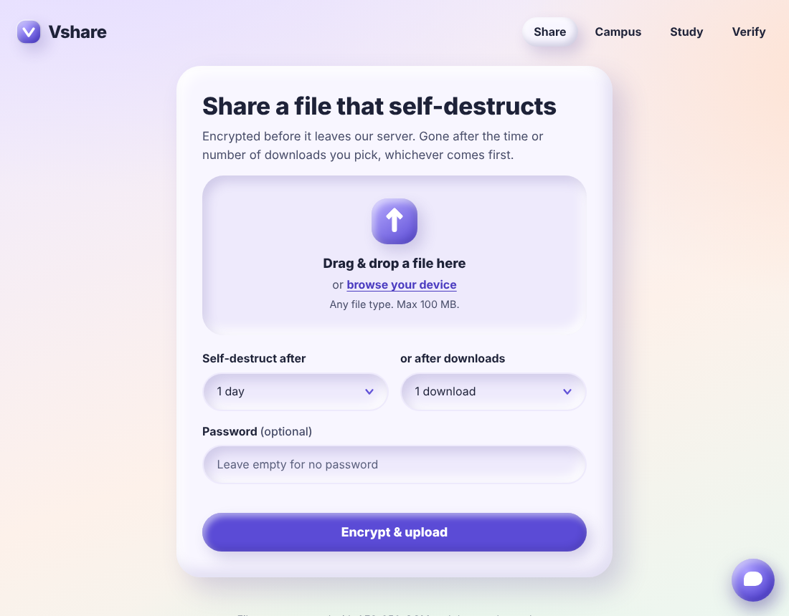
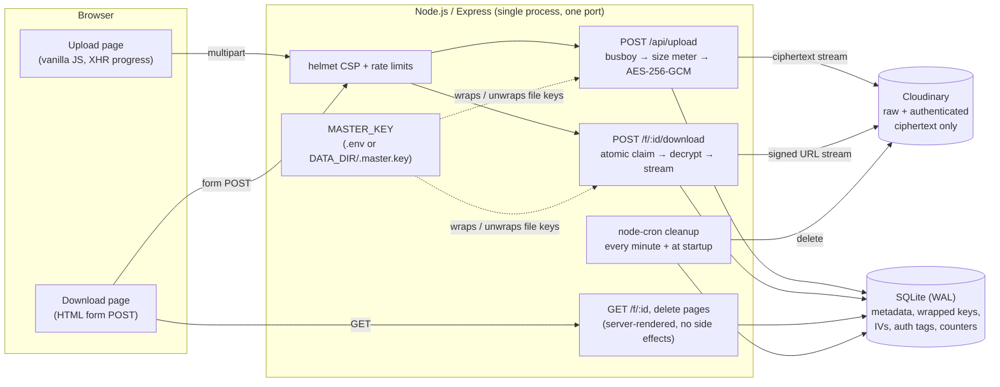
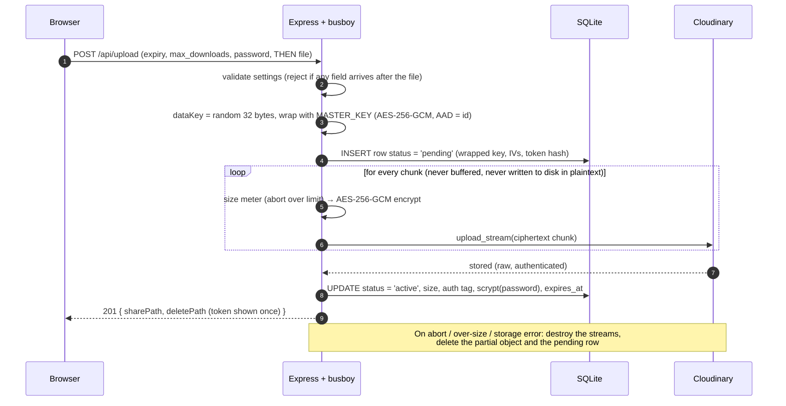
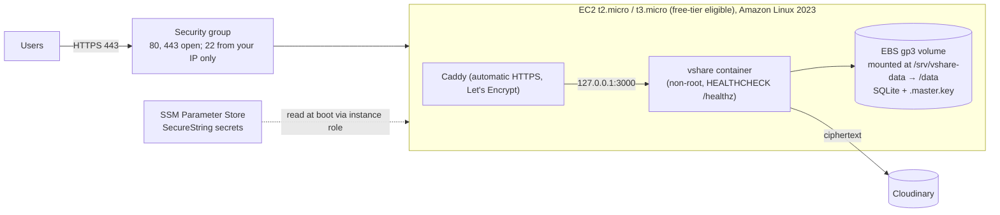

# Vshare: self-destructing, encrypted file sharing

Vshare lets you share a file through a link that **destroys itself** after a time limit
(10 minutes to 7 days) and/or a number of downloads (1 to 10), whichever comes first.
Every file is encrypted with its own AES-256-GCM key **before it leaves the server**, so
the storage provider (Cloudinary) only ever holds ciphertext.

Built as an AWS course project and portfolio piece: one Node.js process serves the API
and the frontend, with SQLite for metadata and Cloudinary for (encrypted) blobs.



---

## Contents

- [Features](#features)
- [Tech stack](#tech-stack)
- [Quick start on Windows (PowerShell)](#quick-start-on-windows-powershell)
- [Quick start on macOS / Linux](#quick-start-on-macos--linux)
- [Configuration](#configuration)
- [Architecture](#architecture)
- [Security design](#security-design)
- [Testing and real results](#testing-and-real-results)
- [Docker](#docker)
- [Deploy on AWS](#deploy-on-aws)
- [Limitations (honest)](#limitations-honest)
- [Future work](#future-work)
- [Project structure](#project-structure)
- [Screenshots](#screenshots)

---

## Features

| | Feature |
|---|---|
| ⬆️ | Drag-and-drop or click upload of any file type, with **real upload progress** (XHR) and clear messages for too-large or failed uploads |
| ⏱️ | Destruction rules, **combinable**: expire after 10 min / 1 h / 1 day / 7 days, and/or after N downloads (1 to 10) |
| 🔑 | Optional password per file (scrypt + constant-time comparison) |
| 🔗 | Share link with copy button + a **private "delete now" link** |
| 📄 | Download page with file name, size, remaining downloads, **live countdown**, password field. **Opening the page never uses up a download** |
| 💨 | Expired, used-up or deleted files show a friendly *"This file has self-destructed"* page (**HTTP 410**) with a CSS-only "poof" |
| 🔐 | **Envelope encryption**: random 256-bit key per file, AES-256-GCM, streamed; key wrapped with a `MASTER_KEY` |
| 🧹 | Cleanup every minute (node-cron) and at startup: expired, used-up and abandoned partial uploads are removed from storage **and** DB; files are deleted right after their final allowed download |
| ❤️ | `GET /healthz` → `ok` for Docker / AWS health checks |
| 🎨 | Claymorphism UI: plain HTML/CSS/vanilla JS, no build step, no CDN, works offline; responsive to 360 px; keyboard + screen-reader friendly; respects `prefers-reduced-motion` |

## Tech stack

| Layer | Choice |
|---|---|
| Runtime | Node.js 18+ (tested on 18.20.8, 20.20.2 and 22.22.0), CommonJS |
| Web | Express 5 (API **and** static frontend on one port), helmet (strict CSP), express-rate-limit |
| Uploads | busboy (streaming multipart parser) |
| Database | SQLite via better-sqlite3 (WAL mode), auto-created on first run |
| Storage | Cloudinary (`resource_type: "raw"`, `type: "authenticated"`, `upload_stream`, signed downloads streamed through the server). Local mock storage with `STORAGE=mock` |
| Crypto | Node `crypto`: AES-256-GCM, scrypt, `timingSafeEqual`, SHA-256 |
| Jobs | node-cron |
| IDs | nanoid v3 (CommonJS-compatible) |
| Config | dotenv |
| Tests | Node's built-in `node:test` + `assert` (no test framework dependency) |

---

## Quick start on Windows (PowerShell)

Requires **Node.js 20 or 22 LTS** (x64). `better-sqlite3` ships prebuilt binaries for these.

### Offline mode (no Cloudinary account needed): three commands

```powershell
npm install
npm run start:mock
Start-Process http://localhost:3000
```

`start:mock` stores encrypted files in `.mock_storage\` instead of Cloudinary.

### With Cloudinary: three commands

```powershell
npm install
Copy-Item .env.example .env ; notepad .env   # fill in the 3 CLOUDINARY_* values
npm start
```

Then open <http://localhost:3000>. If the port is busy you get a clear message; use
`$env:PORT=3001; npm start`.

> If Cloudinary credentials are missing and `STORAGE` is not `mock`, the server prints
> what is missing and exits cleanly instead of crashing.

## Quick start on macOS / Linux

```bash
npm install
npm run start:mock          # offline, or: cp .env.example .env && npm start
open http://localhost:3000  # xdg-open on Linux
```

---

## Configuration

All variables are optional except the Cloudinary credentials when `STORAGE=cloudinary`.
The size limit is defined in exactly one place: [`src/config.js`](src/config.js)
(`MAX_FILE_SIZE_BYTES`).

| Variable | Default | Description |
|---|---|---|
| `STORAGE` | `cloudinary` | `cloudinary` or `mock` (local folder, offline) |
| `CLOUDINARY_CLOUD_NAME` | | Cloudinary cloud name (required for `cloudinary`) |
| `CLOUDINARY_API_KEY` | | Cloudinary API key (required for `cloudinary`) |
| `CLOUDINARY_API_SECRET` | | Cloudinary API secret (required for `cloudinary`) |
| `CLOUDINARY_FOLDER` | `vshare` | Folder prefix for stored objects |
| `MASTER_KEY` | *(generated)* | 32-byte key as 64 hex chars (or base64). If empty, one is generated **once** and saved to `DATA_DIR/.master.key` (git-ignored, mode 600). **Losing it makes all stored files unreadable.** Never logged. |
| `PORT` | `3000` | HTTP port |
| `HOST` | `0.0.0.0` | Bind address |
| `DATA_DIR` | `./data` | SQLite database (`vshare.db`) and `.master.key` |
| `MOCK_STORAGE_DIR` | `./.mock_storage` | Where mock storage writes ciphertext objects |
| `MAX_FILE_SIZE_BYTES` | 10 MB (cloudinary) / 100 MB (mock) | Upload limit. Cloudinary's **free plan caps raw uploads at 10 MB**, hence the default |
| `TRUST_PROXY` | `false` | Set to `1` behind exactly one reverse proxy (Caddy/nginx) so rate limiting sees real client IPs |
| `LOG_LEVEL` | `info` | `debug`, `info`, `warn`, `error`, `silent` |
| `NODE_ENV` | `development` | `production` in Docker. `test` (with `STORAGE=mock` only) enables test hooks |

Generate a master key:

```bash
node -e "console.log(require('crypto').randomBytes(32).toString('hex'))"
```

**Test-only hooks.** `expiry_seconds` (short expiry), `TEST_MAX_FILE_SIZE_BYTES` (tiny
limit) and `POST /__test__/cleanup` exist **only** when `STORAGE=mock` **and**
`NODE_ENV=test`. There is no other switch; a test verifies they are rejected/absent
otherwise.

---

## Architecture



### Upload sequence



### Download sequence

```mermaid
sequenceDiagram
  autonumber
  participant B as Browser
  participant S as Express
  participant DB as SQLite
  participant CL as Cloudinary

  B->>S: GET /f/:id (link previews too)
  S->>DB: SELECT (read only, never counts)
  S-->>B: page: name, size, remaining, countdown, password field
  B->>S: POST /f/:id/download (password in body)
  S->>S: verify scrypt (timingSafeEqual); 5 failures → lock 15 min
  S->>DB: UPDATE downloads = downloads + 1 WHERE active AND not expired<br/>AND not locked AND downloads < max (one atomic statement)
  alt 0 rows changed
    S-->>B: 410 "This file has self-destructed"
  else claimed
    S->>CL: GET signed URL (streamed)
    CL-->>S: ciphertext stream
    S->>S: unwrap key → AES-256-GCM decrypt (last chunk held until tag verifies)
    S-->>B: 200 stream, Content-Length = original size, Content-Disposition (RFC 5987)
    alt finished
      S->>DB: completed_downloads + 1 → purge storage + row if it was the last one
    else client abort / auth-tag failure / storage error
      S->>DB: downloads - 1 (rollback, the download was not used up)
    end
  end
```

---

## Security design

### Envelope encryption (AES-256-GCM)
- Each upload gets a fresh random **256-bit data key** and a random 96-bit IV.
- The file is encrypted **as a stream** (busboy → size meter → `createCipheriv('aes-256-gcm')`
  → storage). Plaintext is never written to disk and never buffered as a whole.
- The data key is **wrapped** with the `MASTER_KEY` (AES-256-GCM, its own IV). SQLite stores
  only the wrapped key, the two IVs and the auth tags.
- The file id is bound as **AAD** into both GCM operations, so a wrapped key or ciphertext
  copied onto another row fails authentication.
- GCM is a stream mode with no padding, so `Content-Length` = original size.
- **Tamper handling:** GCM can only verify the tag at the very end. The decrypt stream
  **withholds the most recent plaintext chunk** until `final()` verifies the tag. On a
  mismatch the connection is cut before the full `Content-Length` arrives (the browser marks
  the download as failed) and the download count is rolled back. Tested.

### Passwords
- `crypto.scrypt` (N = 2¹⁵, r = 8, p = 1, 16-byte random salt, 32-byte output), compared
  with `crypto.timingSafeEqual`. Unicode is NFKC-normalised.
- **Lockout:** 5 consecutive wrong attempts lock the file for 15 minutes (`locked_until`),
  in a single `UPDATE … RETURNING` statement. A correct password resets the counter.
  **Files are never deleted because of wrong passwords.** Plus a per-IP rate limit.
- The password travels in the POST body only, never in a URL.

### Atomic download counter
```sql
UPDATE files SET downloads = downloads + 1
WHERE id = ? AND status = 'active' AND expires_at > :now
  AND (locked_until IS NULL OR locked_until <= :now)
  AND (max_downloads IS NULL OR downloads < max_downloads)
```
One statement, so SQLite serialises it: 6 simultaneous downloads of a 1-download file
→ exactly one succeeds (tested). If the stream does not finish (client abort, decryption or
auth-tag failure, storage error) the claim is rolled back. A separate `completed_downloads`
counter decides when a file is used up, so a file is never purged while a parallel download is
still streaming.

### Only POST counts
`GET /f/:id` (and link-preview bots) only render the page. `HEAD` is handled **explicitly**
(Express would otherwise route it to GET): `HEAD /f/:id` returns the status with no body,
`HEAD /f/:id/download` returns 405. `GET /f/:id/download` redirects to the page.

### Delete links
`/f/:id/delete?token=…`: the token is `nanoid(32)` (~190 bits); only its **SHA-256** is
stored and compared with `timingSafeEqual`. `GET` shows a confirmation page; deletion only
happens on `POST` (token in a hidden form field). The token is redacted from request logs.

### Web hardening
- **helmet** with a strict CSP: `default-src 'self'; script-src 'self'; style-src 'self';
  frame-ancestors 'none'; form-action 'self'; object-src 'none'; base-uri 'none'`.
  No inline scripts or styles anywhere; dynamic data goes through `data-*` attributes and
  every value in server-rendered HTML is escaped.
- `Referrer-Policy: no-referrer`, `X-Content-Type-Options: nosniff`, `Cache-Control: no-store`
  and `X-Robots-Tag: noindex` on share pages. Risky stored MIME types (HTML, SVG, XML, JS)
  are served as `application/octet-stream`, always with `Content-Disposition: attachment`.
- **Rate limits per IP** (15-minute window): 1000 requests overall, 30 uploads,
  60 download POSTs, 30 delete requests. Relaxed only under `NODE_ENV=test`.
- Storage object ids are random `nanoid(21)` (~126 bits), validated by regex in every adapter,
  so there is no path traversal. Original file names are sanitised and used only as metadata.
- Upload size enforced **mid-stream**; partial objects are deleted on abort or error.
  Settings fields must precede the file, or the upload is rejected.
- Errors: friendly HTML for browser forms, `{ "error": "…" }` for `Accept: application/json`
  callers, correct status codes, **no stack traces** (custom final error handler).
- Secrets, keys, passwords and delete tokens are never logged. Graceful shutdown on SIGTERM.

### Threat model

| Threat | Protected? | How / why not |
|---|---|---|
| Storage provider breach (Cloudinary) | ✅ Yes | Cloudinary holds only AES-256-GCM ciphertext; keys never leave the server |
| Database file leaked on its own | ✅ Yes, for file contents | File keys are wrapped by `MASTER_KEY`; passwords are scrypt hashes; delete tokens are SHA-256 hashes |
| Guessing share links | ✅ Yes | 126-bit random ids; unknown ids return 410 |
| Password brute force | ✅ Mitigated | scrypt cost, 5-attempt / 15-minute lock per file, per-IP rate limit |
| Race to download more than allowed | ✅ Yes | Single atomic `UPDATE … WHERE downloads < max` (tested with 6 parallel requests) |
| Link previews / scanners burning a one-time link | ✅ Yes | Only `POST` counts; `GET`/`HEAD` never do |
| Tampered ciphertext in storage | ✅ Detected | GCM auth tag + AAD; last chunk withheld; count rolled back |
| XSS / clickjacking | ✅ Mitigated | Output escaping, strict CSP without `unsafe-inline`, `frame-ancestors 'none'` |
| Eavesdropping on the network | ⚠️ Only with HTTPS | Deploy behind Caddy/nginx with TLS (see AWS section) |
| Full server compromise (DB **and** `MASTER_KEY`) | ❌ No | The master key lives on the same host (use KMS to improve) |
| Malicious server operator | ❌ No | The server sees plaintext while streaming; there is no client-side encryption |
| Malware distribution | ❌ No | No virus scanning |
| Volumetric DoS | ⚠️ Partially | Rate and size limits only; no WAF / CDN in front |

---

## Testing and real results

```bash
npm test                  # starts the real server (STORAGE=mock, NODE_ENV=test) and tests it over HTTP
npm run test:cloudinary   # MANUAL: live upload/download/delete round trip against Cloudinary (needs .env)
npm run bench             # streaming benchmark (prints server peak memory)
node scripts/race-demo.js http://localhost:3000/f/<id>   # 6 parallel downloads of a live link
```

`npm test` covers: upload + download of **pdf, pptx, docx, zip, png, txt and a 20 MB file**
with byte-for-byte SHA-256 comparison; first-download-only; N downloads; expiry with a 1 s
expiry; correct / missing / wrong password; the 15-minute lockout; **6 simultaneous
downloads of a 1-download file (exactly one succeeds)**; cleanup of expired files and
abandoned partial uploads (storage + DB); oversize uploads (with `Content-Length` **and**
chunked, rejected mid-stream); HEAD/GET never count; interrupted downloads roll back;
the delete flow (GET only confirms, wrong token rejected, POST deletes); tampered ciphertext
fails and rolls back the count; settings-after-file rejected; test hooks impossible outside
test mode.

Real output (Node 22.22.0, Linux sandbox; per-test durations trimmed for width; full
version in [`docs/test-results.txt`](docs/test-results.txt)):

```text
▶ oversize uploads (TEST_MAX_FILE_SIZE_BYTES = 1 MB)
  ✔ reports the limit via /api/config
  ✔ accepts a file exactly at the limit
  ✔ rejects an oversize upload with Content-Length (413, nothing stored)
  ✔ rejects an oversize CHUNKED upload mid-stream and deletes the partial object
▶ test hooks cannot be enabled outside NODE_ENV=test + STORAGE=mock
  ✔ ignores TEST_MAX_FILE_SIZE_BYTES
  ✔ rejects expiry_seconds
  ✔ has no cleanup endpoint
▶ basics
  ✔ GET /healthz returns ok and nothing sensitive
  ✔ serves the upload page with a strict CSP (no inline scripts/styles)
▶ upload and download round trips (byte-for-byte SHA-256)
  ✔ report.pdf (596 bytes)
  ✔ slides.pptx (263221 bytes)
  ✔ essay.docx (917 bytes)
  ✔ bundle.zip (100240 bytes)
  ✔ picture.png (32328 bytes)
  ✔ notes – ünïcödé.txt (43 bytes)
  ✔ 20 MB file streams through intact
▶ download limits
  ✔ max 1 download: only the first download works, then 410 and the file is purged
  ✔ max N downloads: exactly N succeed
  ✔ 6 simultaneous downloads of a 1-download file: exactly one succeeds
  ✔ opening the page, GET on the download URL and HEAD requests never count
  ✔ an interrupted download is rolled back and does not count
▶ expiry and cleanup
  ✔ a file expires after its time limit (410) and cleanup removes it from storage and DB
  ✔ cleanup removes abandoned partial uploads (pending rows + partial objects)
▶ passwords
  ✔ correct password downloads; missing or wrong password re-renders the page with a message
  ✔ 5 wrong attempts lock the file for 15 minutes; it is never deleted
▶ delete link
  ✔ GET only shows a confirmation; wrong tokens are rejected; POST deletes
▶ integrity
  ✔ tampered ciphertext fails the GCM check, the client never gets the full file, and the count is rolled back
▶ upload validation
  ✔ rejects settings sent after the file and leaves nothing behind
  ✔ rejects invalid settings with JSON errors
  ✔ sanitises path-traversal file names (metadata only)
  ✔ unknown ids give 410, malformed ids 404, and errors never leak stack traces
ℹ tests 31
ℹ suites 10
ℹ pass 31
ℹ fail 0
ℹ duration_ms 3683
```

The same 31 tests also passed on **Node 18.20.8** and **Node 20.20.2** in the sandbox.
The PDF/PNG/ZIP/DOCX/PPTX fixtures are generated in memory with correct signatures and
container structure ([`test/fixtures.js`](test/fixtures.js)).

**Streaming benchmark** (`npm run bench`, mock storage, loopback, 4-vCPU sandbox), in
[`docs/benchmark.txt`](docs/benchmark.txt). Server peak memory stays about the same
whether the file is 100 MB or 500 MB, which shows the server streams instead of buffering:

| File | Upload | Download | Server peak RSS (idle ≈ 73 MB) | SHA-256 match |
|---|---|---|---|---|
| 100 MB | 0.35 s | 0.28 s | 114.0 MB | ✅ |
| 500 MB | 2.14 s | 1.47 s | 112.9 MB | ✅ |

(Loopback numbers with local storage; real-world speed is bounded by the network and Cloudinary.)

**Not verified in the sandbox:** live Cloudinary (no credentials / network access; run
`npm run test:cloudinary` yourself), the Docker image build, and the AWS deployment.

---

## Docker

```bash
cp .env.example .env            # fill in Cloudinary credentials and a MASTER_KEY
docker compose up -d --build
curl http://localhost:3000/healthz   # -> ok
```

- Multi-stage build on `node:22-bookworm-slim`; the runtime image runs as the **non-root
  `node` user**, contains only production dependencies, and has a `HEALTHCHECK` on `/healthz`.
- `/data` is a **volume** holding the SQLite DB and `.master.key`, so they survive container
  restarts and upgrades.
- `init: true` gives the container a proper PID 1 so `SIGTERM` reaches Node for a graceful shutdown.
- Docker Hub rate limits? Build from the AWS ECR Public mirror instead:
  `docker build --build-arg NODE_IMAGE=public.ecr.aws/docker/library/node:22-bookworm-slim -t vshare .`

> **Not verified in sandbox.** `docker build --check` (Dockerfile lint) reported *no warnings*
> and `docker compose config` validated the compose file, but a full image build could not
> run in the sandbox (registry rate limits and restricted egress). Please run
> `docker compose up --build` once locally.

---

## Deploy on AWS

> ⚠️ **Everything in this section is not verified in sandbox.** It is a step-by-step guide
> written for the course submission; follow it on your own AWS account.

### Target architecture



### 1. Launch the instance
1. EC2 → Launch instance → **Amazon Linux 2023**, **t2.micro or t3.micro** (whichever is
   free-tier eligible in your account/region), 8–20 GB gp3 root volume.
2. Add a **second EBS gp3 volume** (e.g. 5 GB) for data, so you can snapshot and re-attach it
   independently of the instance.
3. **Security group:** inbound `80/tcp` and `443/tcp` from `0.0.0.0/0` (and `::/0`), `22/tcp`
   from **your IP only**. Do **not** open 3000.
4. Attach an **IAM instance role** allowing `ssm:GetParametersByPath` on
   `arn:aws:ssm:<region>:<account>:parameter/vshare/*` (+ `kms:Decrypt` for the key used by
   SecureString).
5. Allocate an **Elastic IP** and point a DNS `A` record (e.g. `vshare.example.com`) at it.

### 2. Prepare the host
```bash
sudo dnf install -y docker git
sudo systemctl enable --now docker
sudo usermod -aG docker ec2-user && newgrp docker
# Docker Compose v2 plugin
sudo mkdir -p /usr/local/lib/docker/cli-plugins
sudo curl -sSL "https://github.com/docker/compose/releases/latest/download/docker-compose-linux-$(uname -m)" \
  -o /usr/local/lib/docker/cli-plugins/docker-compose
sudo chmod +x /usr/local/lib/docker/cli-plugins/docker-compose

# Data volume (check the device name with lsblk; often /dev/nvme1n1)
sudo mkfs -t xfs /dev/nvme1n1
sudo mkdir -p /srv/vshare-data
echo '/dev/nvme1n1 /srv/vshare-data xfs defaults,nofail 0 2' | sudo tee -a /etc/fstab
sudo mount -a
sudo chown 1000:1000 /srv/vshare-data     # the container's non-root "node" user
```

### 3. Secrets in SSM Parameter Store
Create the parameters once (from your machine or CloudShell):
```bash
aws ssm put-parameter --name /vshare/CLOUDINARY_CLOUD_NAME --type SecureString --value "<cloud>"
aws ssm put-parameter --name /vshare/CLOUDINARY_API_KEY    --type SecureString --value "<key>"
aws ssm put-parameter --name /vshare/CLOUDINARY_API_SECRET --type SecureString --value "<secret>"
aws ssm put-parameter --name /vshare/MASTER_KEY            --type SecureString \
  --value "$(node -e "console.log(require('crypto').randomBytes(32).toString('hex'))")"
```
On the instance, render them into `.env` (re-run after rotating a secret):
```bash
git clone <your-repo-url> vshare && cd vshare
aws ssm get-parameters-by-path --path /vshare/ --with-decryption \
  --query 'Parameters[*].[Name,Value]' --output text \
  | awk '{ sub("/vshare/", "", $1); print $1 "=" $2 }' > .env
printf 'STORAGE=cloudinary\nTRUST_PROXY=1\n' >> .env
chmod 600 .env
```
*(Simpler alternative for a demo: create `.env` on the instance by hand with `chmod 600`.)*

### 4. Run the container (bound to localhost only, data on EBS)
Create `docker-compose.override.yml` next to `docker-compose.yml`:
```yaml
services:
  vshare:
    ports: !override
      - "127.0.0.1:3000:3000"
    volumes: !override
      - /srv/vshare-data:/data
```
```bash
docker compose up -d --build
docker compose ps            # STATUS shows "(healthy)" once /healthz answers
curl -s http://127.0.0.1:3000/healthz   # -> ok
```

### 5. HTTPS with Caddy
```bash
sudo dnf install -y 'dnf-command(copr)' && sudo dnf copr enable -y @caddy/caddy && sudo dnf install -y caddy
sudo tee /etc/caddy/Caddyfile >/dev/null <<'EOF'
vshare.example.com {
    encode gzip
    request_body {
        max_size 12MB
    }
    reverse_proxy 127.0.0.1:3000
}
EOF
sudo systemctl enable --now caddy
```
Caddy obtains and renews a Let's Encrypt certificate automatically (port 80 must be
reachable). With nginx instead: `proxy_pass http://127.0.0.1:3000;`,
`client_max_body_size 12m;`, `proxy_request_buffering off;`, then `certbot --nginx`.
Keep `TRUST_PROXY=1` so rate limits see the real client IP.

### 6. Health checks and operations
- **Container:** Docker `HEALTHCHECK` hits `/healthz` every 30 s; `restart: unless-stopped`
  restarts it after a crash or reboot.
- **External:** add a Route 53 health check (HTTPS, path `/healthz`) and/or a CloudWatch
  alarm on the EC2 status checks.
- **Backups:** schedule EBS snapshots of the data volume with Amazon Data Lifecycle Manager.
  The DB is useless without `MASTER_KEY` (kept in SSM), and vice versa.
- **Updates:** `git pull && docker compose up -d --build`.

### Why a single instance?
SQLite is a file on local disk with a single writer, and the app keeps in-flight download
and upload bookkeeping in memory. That is simple, fast and correct for one instance, and
fits the free tier, but **it cannot be shared by several instances**.

**What changes to scale out:**
1. Move metadata to **RDS PostgreSQL** (the atomic `UPDATE … WHERE downloads < max` maps
   directly) or **DynamoDB** (conditional `UpdateItem`).
2. Replace in-memory in-flight tracking with DB columns or leases; run cleanup in exactly one
   place (a scheduled ECS task / EventBridge + Lambda, or an advisory lock).
3. Move rate-limit counters to a shared store (ElastiCache Redis).
4. Put stateless containers behind an **Application Load Balancer** with the ALB health check
   on `/healthz`; terminate TLS at the ALB with ACM.
5. Keep `MASTER_KEY` in Secrets Manager or, better, wrap data keys with **AWS KMS**.

### Alternatives: App Runner or ECS Fargate
Both run the same container image with less server management, but **their local disk is
ephemeral**: the SQLite DB and a generated `.master.key` are lost on every redeploy or
scale event. To use them, provide `MASTER_KEY` from Secrets Manager **and** move metadata to
RDS/DynamoDB (SQLite on EFS is not recommended because of file-locking behaviour). App Runner
health checks would use `/healthz`.

---

## Limitations (honest)

- **Cloudinary raw size limit:** free plans cap raw uploads at **10 MB** (the default
  `MAX_FILE_SIZE_BYTES` for Cloudinary). Paid plans allow more; raise the variable accordingly.
- **Single-instance SQLite:** see *Why a single instance?* above.
- **`MASTER_KEY` lives on the same host** as the database (in `.env` or `.master.key`).
  Someone who compromises the server gets both. A KMS-backed key would improve this.
- **No virus/malware scanning** of uploaded files.
- **The server sees plaintext in transit**: it encrypts and decrypts on the user's behalf.
  There is **no client-side (end-to-end) encryption**; you must trust the operator.
- **GCM tag is checked at the end of a stream:** the client receives most of the plaintext
  before the tag is verified. Vshare withholds the last chunk and aborts on failure, so the
  browser marks the download as failed, but a custom client could keep the partial bytes.
  Chunked authenticated encryption (e.g. per-chunk GCM) would close this.
- Download counting happens when the server **finishes sending** the response; bytes still in
  flight to a client that disconnects at the very last moment would count.
- Time limits are fixed choices; "downloads only" (no time limit) is not offered, so every
  file has a maximum life of 7 days.
- Live Cloudinary, Docker and AWS were **not verified in the sandbox** (see above).

## Future work

- **S3 storage adapter** (same three-method interface: `upload`, `download`, `delete`) with
  SSE-KMS, and presigned multipart uploads for large files.
- **CloudFront** in front of the app (static assets cached, TLS at the edge, AWS WAF).
- **CloudWatch** Logs (awslogs driver), metrics and alarms (5xx rate, cleanup failures, disk).
- **RDS / DynamoDB** for metadata to scale horizontally; **KMS** for key wrapping.
- Optional client-side encryption (key in the URL fragment) for end-to-end confidentiality.

---

## Project structure

```text
vshare/
├── .github/workflows/ci.yml      # npm ci + npm test (STORAGE=mock) on Node 20 and 22
├── docs/
│   ├── benchmark.txt             # real output of npm run bench
│   ├── test-results.txt          # real output of npm test
│   └── screenshots/              # real screenshots taken in the sandbox (Chromium)
├── public/                       # frontend: no build step, no CDN
│   ├── index.html                # upload page
│   ├── favicon.svg
│   ├── css/style.css             # the only stylesheet (claymorphism design tokens)
│   └── js/
│       ├── upload.js             # drag & drop, XHR progress, copy buttons
│       └── download.js           # live countdown
├── scripts/
│   ├── start-mock.js             # npm run start:mock (offline, cross-platform)
│   ├── test-cloudinary.js        # npm run test:cloudinary (manual live test)
│   ├── bench-stream.js           # npm run bench (streaming/memory benchmark)
│   └── race-demo.js              # fire N parallel downloads at a share link (demo)
├── src/
│   ├── server.js                 # entry: startup checks, cron, graceful shutdown
│   ├── app.js                    # Express app: helmet/CSP, rate limits, routes, error handler
│   ├── config.js                 # ALL configuration (incl. MAX_FILE_SIZE_BYTES)
│   ├── crypto.js                 # envelope encryption, streaming GCM, scrypt, tokens
│   ├── db.js                     # SQLite schema + atomic statements
│   ├── files.js                  # purge, in-flight tracking, cleanup sweep
│   ├── http.js                   # content negotiation, errors, filenames, Content-Disposition
│   ├── logger.js                 # levelled logger with URL redaction
│   ├── views.js                  # server-rendered pages (escaped, no inline JS/CSS)
│   ├── routes/
│   │   ├── upload.js             # POST /api/upload (busboy → meter → cipher → storage)
│   │   └── files.js              # /f/:id page, download, delete
│   └── storage/
│       ├── index.js              # adapter factory + credential checks
│       ├── cloudinary.js         # raw + authenticated, upload_stream, signed download
│       ├── mock.js               # local folder (STORAGE=mock)
│       └── id.js                 # object-id validation (no path traversal)
├── test/
│   ├── vshare.test.js            # end-to-end tests against the real server
│   ├── limits.test.js            # size limits + test-hook isolation
│   ├── helpers.js                # spawn server, HTTP helpers, DB/storage inspection
│   └── fixtures.js               # in-memory PDF/PNG/ZIP/DOCX/PPTX/TXT generators
├── .env.example
├── .dockerignore
├── Dockerfile
├── docker-compose.yml
├── DEMO_SCRIPT.md
├── RESUME.md
├── package.json
└── README.md
```

## Screenshots

Real screenshots taken in the sandbox with headless Chromium (mock storage):

| Upload | Share link ready | Download page |
|---|---|---|
|  |  |  |

| Wrong-password lockout | Delete confirmation | Self-destructed (410) |
|---|---|---|
|  |  |  |

Mobile (360 px): 

### Your deployment (placeholders: replace with your own)

| Screenshot | File |
|---|---|
| EC2 instance running (console) | `docs/screenshots/aws-ec2-instance.png` *(add)* |
| Security group inbound rules (80/443, 22 from my IP) | `docs/screenshots/aws-security-group.png` *(add)* |
| SSM Parameter Store parameters (values hidden) | `docs/screenshots/aws-ssm-parameters.png` *(add)* |
| `docker compose ps` showing `(healthy)` | `docs/screenshots/aws-docker-healthy.png` *(add)* |
| App over HTTPS with the padlock | `docs/screenshots/aws-https.png` *(add)* |
| Cloudinary Media Library showing the raw, authenticated (encrypted) object | `docs/screenshots/cloudinary-raw-object.png` *(add)* |
| GitHub Actions CI green on Node 20 and 22 | `docs/screenshots/ci-green.png` *(add)* |

## License

MIT
